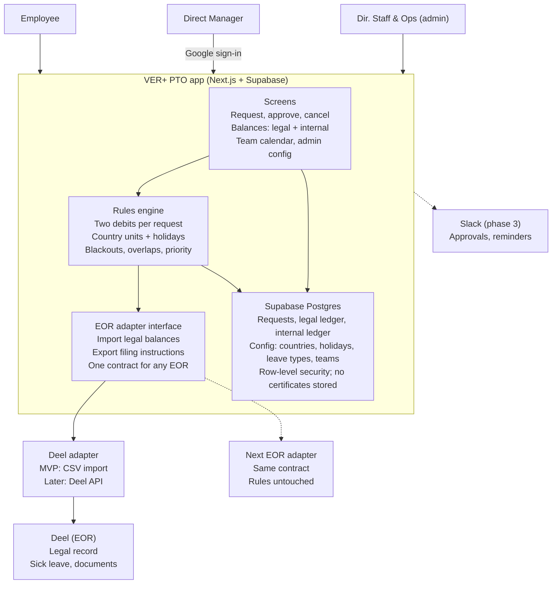
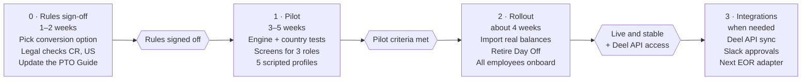

# PTO App — Feasibility Report

Oct 28, 2026 · Miguel Ángel Betancur

## Executive summary

**Verdict: feasible and worth building, as a small focused tool — but one business rule must change before any code is written.**

- **Why build:** no off-the-shelf tool reconciles a legal ledger (EOR, working days in CO/UY/CR) with an internal ledger (30 calendar days). Day Off can't do it and Deel only knows the legal side. The gap is real and creates manual work and wrong balances today.
- **Why it's affordable:** 30–80 users, 3 roles, 6 countries, one policy. Next.js + Supabase fits on free or near-free tiers. A 5-employee pilot with fake data is a 3–5 week effort for Miguel + Claude.
- **The blocker:** the chosen *residual* top-up rule can be gamed. Splitting the 15 legal days into Mon–Fri weeks consumes fewer calendar days, which inflates the top-up (see Business rules engine). The rule needs a fix before it becomes code.
- **Biggest ongoing risk:** maintenance (holidays, law changes, EOR change) with a team of one. Mitigated by keeping rules in config, not code, and keeping the EOR behind an adapter.

**Recommendation:** go ahead with the pilot, after People approves a corrected conversion rule and confirms the 5 open questions at the end of this report.

## Problem & current state

Two ledgers in two units, and no system that adds them up. The PTO Guide (effective April 2026) promises 30 calendar days of vacation, but each country's law — tracked in Deel — counts differently.

| Country | Legal vacation | Unit | Internal top-up needed? | Platforms today |
| --- | --- | --- | --- | --- |
| Colombia | 15 days | Working | Yes | Deel + Day Off |
| Uruguay | 20 days | Working | Yes | Deel + Day Off |
| Costa Rica | 2 weeks / year worked | Working (Saturday rule to verify) | Yes | Deel + Day Off |
| United States | Varies by state | Varies | Yes | Deel + Day Off |
| Brazil | 30 days | Calendar | No | Deel only |
| Panama | 30 days | Calendar | No | Deel only |

**What breaks today:**

- Deel shows "15 days" and Day Off shows its own balance. No one sees the real total: "you have X calendar days left out of 30."
- Day Off can't apply custom conversion rules and doesn't know what was consumed in Deel.
- Rules live in a guide, not a system: legal first, no weekend splitting, no team overlaps, priority to whoever used fewer days, blackout periods. Compliance depends on people reading it.
- Every split leave (vacation, maternity, paternity) needs two requests and two approvals, cross-referenced by hand in Notes fields.
- Leave types are split across tools, so there's no single view of everyone's time off.

## Proposed solution & decisions so far

An internal web app that becomes the source of truth for the company policy. It replaces Day Off and treats the EOR as an external legal ledger it reads from and points employees to.

| Topic | Decision |
| --- | --- |
| Top-up rule | Residual: 30 calendar days minus the calendar days the legal portion covered (challenged below) |
| Policy year | Hire anniversary |
| Internal grant | Full 30 days upfront each policy year |
| EOR model (MVP) | Plan in the app, file in the EOR; the admin reconciles. API sync later |
| Scale | 30–80 people |
| Countries | Colombia, Uruguay, Costa Rica, Brazil, Panama, United States |
| Platform | Standalone web app; Slack later if the pilot works |
| Day Off | Fully replaced |
| Roles | Employee, Direct Manager, Dir. Staff & Ops (admin) |
| Entities | VER+ and VERE, same policy |
| Leave types | Vacation (legal + top-up), Maternity/Paternity, Sick, Bereavement, Marriage, Family Emergency, Year-end shutdown |
| Weekend splitting | Blocked |
| Teams | Admin-defined, used for the no-overlap rule |
| Stack | Next.js + Supabase, deployed on Vercel |
| Pilot | 5 employees, made-up data |
| Builder | Miguel + Claude |

## Business rules engine

The engine is the product; the screens are secondary. Its core job is to turn one request into two debits: working days against the legal ledger, and policy units against the internal ledger.

### Finding: the residual rule rewards fragmenting leave

Worked examples for a Colombian employee (2027 Colombian holidays, 15 legal working days):

| Scenario | Calendar days the legal portion covers | Top-up under residual | Total working days off |
| --- | --- | --- | --- |
| One block, Mon 1 Feb – Fri 19 Feb | 19 | 11 | about 22 |
| Same 15 days as three separate Mon–Fri weeks | 15 | 15 | up to 30 |
| One block, Mon 15 Mar – Wed 7 Apr (San José, Holy Thursday, Good Friday inside) | 24 | 6 | about 21 |

Two problems come out of this:

1. **Gaming:** three Mon–Fri weeks give about 8 more working days off than one continuous block. The current no-weekend-split rule only catches Friday + Monday; it doesn't catch whole Mon–Fri weeks.
2. **Holiday unfairness:** taking vacation over Semana Santa shrinks the top-up by 5 days compared with February.

The root cause isn't the residual formula. It's "calendar days" itself, which only works cleanly when leave is taken in one block.

### Options to fix it

| Option | How it works | Gaming | Holidays | Policy wording change |
| --- | --- | --- | --- | --- |
| A. Keep residual | As decided | Open | Penalised | None |
| B. Charge trailing weekends | Any leave that covers a Friday also charges that Sat–Sun. A Mon–Fri week costs 7 | Mostly closed (Mondays-only remains a gap) | Still penalised | Small |
| **C. Working-day equivalent (recommended)** | 30 calendar days = 21 working days in 5-day-week countries. Top-up = 21 minus the legal working days (CO = 6, UY = 1). Brazil and Panama stay at 30 calendar | Closed | Neutral (holidays never charged) | Medium: "30 calendar days, equivalent to 21 working days" |

Option C uses the same unit as Deel in each country, so the two ledgers reconcile one-to-one and the no-weekend-split rule becomes unnecessary. The 30×5/7 = 21.4 rounding (21 or 22) is a People decision.

### Other rules the engine must encode

- **Order of use:** debit the legal ledger first. Legal days may go negative ("on credit") until anniversary accrual, as the guide allows. Admin-configurable cap.
- **Upfront internal grant vs. legal accrual:** all 30 days are available on day 1, so the top-up can only be used once the legal balance (including credit) is exhausted.
- **Carryover:** top-up follows each country's legal carryover parameters. Year-end shutdown, Marriage and Family Emergency never carry over.
- **Maternity / Paternity:** 126 / 60 calendar days. Legal portion per country plus a consecutive top-up. Calendar-based, so no gaming issue.
- **Brazil:** Abono Pecuniário (up to 10 days sold) reduces days taken, not entitlement. Flag it, don't calculate it.
- **Validation at request time:** blackout periods, team overlaps (admin-defined teams), advance notice (1 week; 30 days for maternity/paternity), and priority to whoever used fewer days when two pending requests collide.
- **Everything is configuration:** per-country legal days, units, working-week pattern and holiday calendar live in tables, not code.

## Architecture

The policy lives in the app; the EOR is a swappable plug-in. Changing EOR means writing one new adapter, not rewriting the rules.

Dashed boxes are later phases. The adapter has only two jobs: bring legal balances and approvals in, and send filing instructions out (as text in the MVP, through the API later).

**Core data model:**

| Table | Holds | Key fields |
| --- | --- | --- |
| employees | One row per person | entity (VER+ / VERE), country, hire date, team, manager, role, e-mail |
| country_rules | Legal setup per country | legal days, unit (working / calendar), working-week pattern, carryover |
| holidays | Official holidays per country and year | date, name, admin override |
| leave_types | The 7 leave types | legal portion?, top-up?, carries over?, needs a document? |
| requests | One row per request | type, dates, status, approver, exception flag |
| ledger_entries | Every debit and credit | ledger (legal / internal), units, source (app / EOR import), reconciled on |
| eor_snapshots | Imported legal balances | provider, date, balance, raw payload |

Balances are never stored as a single number. They're the sum of ledger entries, so every figure can be audited and recalculated when a rule changes.

## Build vs. buy

Building wins, narrowly: buying still leaves the Deel reconciliation manual, which is the core problem.

| Option | Custom conversion rules | Knows the EOR legal balance | Approvals + team rules | Cost / effort | Verdict |
| --- | --- | --- | --- | --- | --- |
| Day Off (today) | No | No | Basic | Low | Doesn't solve the problem |
| HRIS with leave module (Factorial, Personio, Humaans, BambooHR) | Partial: multiple policies, calendar or working days | No; overlaps Deel and needs manual sync | Yes | Per-seat subscription + migration | Over-scoped; adds a 3rd system next to the EOR |
| Deel's own time-off policies | Limited to what Deel supports per country | Yes | Yes | Included | Locks us into Deel, which is what we want to avoid |
| Low-code (Retool, Glide, Softr + DB) | Yes, via scripts | Manual | Yes | Seats + logic in a tool few people can maintain | Viable, but date logic gets awkward fast |
| **Custom app (Next.js + Supabase)** | **Full** | **Via adapter: manual now, API later** | **Full** | **Near-zero hosting; Miguel's time** | **Recommended** |

Before committing, check two things with Deel: what custom time-off policies it supports per country, and what its time-off API offers on your plan. If Deel could hold the top-up as a second policy, the app would shrink to a calculator and dashboard.

## Feasibility assessment

Feasible on all four dimensions. Operations is the weakest one, because the MVP still depends on manual reconciliation with the EOR.

| Dimension | Rating | Why | What it depends on |
| --- | --- | --- | --- |
| Technical | High | Date and holiday math is a solved problem (holiday libraries cover CO, UY, CR, BR, PA, US). The scale is tiny. Supabase gives Google login, Postgres and row-level security out of the box | Rules agreed before coding; holiday data checked against each country's official calendar |
| Operational | Medium | The admin has to mirror Deel approvals until API sync exists. Employees still file the legal portion in Deel | A short reconciliation routine (weekly); clear "what to file in Deel" instructions generated per request |
| Legal / compliance | Medium-high | The app never replaces the legal record; Deel stays authoritative for statutory days. Health data stays in Deel | Legal sign-off on the conversion rule per country (especially Costa Rica and the US); a privacy notice for employee data (Colombia Law 1581 and local equivalents) |
| Cost | High | Vercel and Supabase free tiers cover a 5-person pilot. Paid tiers at 80 users are roughly tens of USD per month (verify current pricing) | Miguel's time is the real cost: about 3–5 weeks for the pilot, then a few hours per month of upkeep |

**Build effort estimate (Miguel + Claude):**

1. Rules engine + tests per country: 1–2 weeks
2. Data model, auth, roles, admin config screens: 1 week
3. Employee and manager screens (balances, request, approve, team calendar): 1–2 weeks
4. Pilot setup with fake data + fixes: about 1 week

## Risks & mitigations

The two highest risks are a wrong rule becoming code, and the app drifting out of sync with Deel.

| Risk | Likelihood | Impact | Mitigation |
| --- | --- | --- | --- |
| Conversion rule is wrong or gameable (see Business rules engine) | High | High | Agree on Option C (or B) in writing with People + legal before coding; unit tests per country with real 2027 dates |
| App and Deel balances drift apart | High | Medium | The app shows the Deel balance as "last reconciled on date"; weekly admin check; API sync in phase 3 |
| Double entry drives low adoption (app + Deel) | Medium | High | The app generates exact Deel instructions (type, dates, days); approvals happen once in the app, and the admin mirrors them in Deel |
| Bus factor of one (only Miguel maintains it) | Medium | High | Rules in config tables; README + decisions log in the project; boring, mainstream stack |
| Law or holiday changes | Medium | Medium | Yearly review each January; holiday overrides editable by the admin |
| EOR change | Certain (timing unknown) | Medium | EOR adapter interface; legal balances stored as imported snapshots, not live dependencies |
| Sensitive data exposure | Low | High | No certificates or diagnoses stored, only dates and type; row-level security per role |
| Pilot with fake data hides real edge cases | Medium | Medium | Build fake profiles from real situations: Semana Santa leave, a new hire on credit, a maternity split, a US employee |

## Iterations to the proposal

Eight changes, ranked by impact.

| # | Your proposal | Challenge | Recommended change |
| --- | --- | --- | --- |
| 1 | Residual top-up in calendar days | Gameable with Mon–Fri blocks; penalises holidays | Option C: track the policy in working-day equivalents per country (21 in 5-day-week countries) |
| 2 | Weekend splits blocked | Only stops Fri + Mon; not the bigger loophole | Under Option C, drop the rule. Under Option B, replace it with trailing-weekend charging |
| 3 | No CEO role | The guide needs the CEO for blackout overrides, extensions, unpaid leave and the year-end shutdown | Keep 3 roles; add an "exception" flag the admin records on the CEO's behalf, with a note and an attachment |
| 4 | Approvals in the app + filing in Deel | The manager approves twice (app and Deel) | Approve once in the app; the admin mirrors the decision in Deel during reconciliation. Confirm Deel allows admin-side approval |
| 5 | 30 days upfront + anniversary year | A new hire could use the whole top-up while legal days are deeply negative | Cap legal credit (for example, the days accrued by the end of the current year), configurable by the admin |
| 6 | US in scope | Rules vary by state; maybe 1–2 people | Pilot without the US; treat each state as its own "country" config later |
| 7 | Brazil/Panama mirrored | Correct, but vacation there needs no calculation | Read-only mirror for vacation; full flow only for company leave types (Marriage, Family Emergency, Year-end) |
| 8 | Fake data for 5 employees | Fake data hides the hard cases | Script 5 profiles covering the edge cases in Risks & mitigations, and replay 2026 history for 1–2 real volunteers |

**What stays as proposed:** EOR as adapter, replacing Day Off, standalone app first, admin-defined teams, two entities with one policy, and the Next.js + Supabase stack.

## Roadmap & pilot success criteria

Four phases, each opened by a gate. Phase 0 is the one that's easy to skip and expensive to get wrong.

Durations assume Miguel + Claude part-time. Phase 3 only starts if Deel's API (or the next EOR's) supports it.

**Proposed pilot success criteria** (all must pass to open the rollout gate):

- [ ] Engine balances match hand calculations for all 5 profiles, including Semana Santa, legal credit, a maternity split and a Brazil case
- [ ] Every request produces exact Deel filing instructions (type, dates, working days)
- [ ] The weekly reconciliation with Deel takes the admin under 30 minutes
- [ ] No overlap, blackout or advance-notice rule can be bypassed in testing
- [ ] Pilot employees and their managers prefer it to Day Off (short survey)

## Open questions & decisions needed

The first two block the rules engine; the rest can be answered during the pilot.

- [ ] **Conversion rule:** Option A, B or C? If C, is the equivalent 21 or 22 working days? (People + Director of Staff & Ops)
- [ ] **Costa Rica:** does legal vacation count Saturday as a working day? (legal advisor)
- [ ] **Legal credit cap:** how far can a legal balance go negative before the top-up unlocks?
- [ ] **CEO exceptions:** is the admin recording exceptions on the CEO's behalf acceptable?
- [ ] **Deel:** can it hold a custom top-up policy, and what does its time-off API expose on your plan? Can an admin approve on a manager's behalf?
- [ ] **United States:** which states, and is the US in the pilot?
- [ ] **Maternity/Paternity:** legal days per country, to compute each top-up
- [ ] **Uruguay:** confirm 20 working days and the working-week pattern used
- [ ] **Policy wording:** who updates the PTO Guide if the rule changes, and when?
