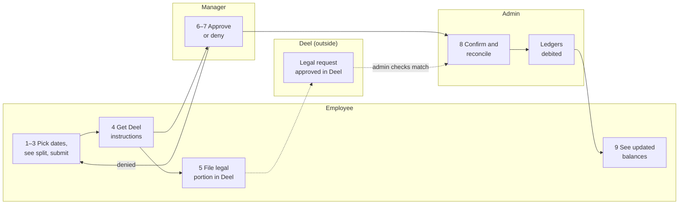

# PTO App — MVP Product Specification

Nov 6, 2026 · Miguel Ángel Betancur · v1.1

This is the product spec for the 5-employee pilot. It's for review before we hand it to an AI coding agent. It covers product behavior only. Everything in it comes from the PTO Guide (April 2026), the feasibility report and the decisions already made. Anything not yet confirmed is labeled as an assumption or an open question.

## 1. MVP scope & exclusions

The MVP is the pilot: a standalone web app where 5 employees with made-up data request, approve and track every leave type. The internal balance is calculated next to the legal (EOR) balance.

**In scope**

- Balances per employee: the legal balance (entered by the admin, shown with a "last reconciled" date), the internal 30-day balance, and the top-up remaining
- Requests for the 7 leave types: Vacation (legal + top-up), Maternity, Paternity, Sick, Bereavement, Marriage/Honeymoon, Family Emergency. Plus Year-end shutdown days
- Automatic split of each vacation request into a legal portion and a top-up portion, with legal used first
- Generated "what to file in Deel" instructions for the legal portion of each request
- Manager approve / deny; admin confirmation and reconciliation against Deel
- Request validation: weekend splitting (blocked), team overlap, blackout periods, advance notice
- Cancel / modify an approved request (cancel and resubmit)
- Team calendar for managers and admin
- Admin configuration: employees, entities (VER+ / VERE), teams, countries, holidays, blackout periods, opening balances, and CEO-approved exceptions (year-end shutdown activation, blackout overrides, extensions, unpaid leave) recorded on the CEO's behalf. Notifications are in-app only: pending queues and status changes
- Countries in the pilot: Colombia, Uruguay, Costa Rica, Brazil, Panama (United States added after the pilot)

**Explicitly excluded from the MVP**

| Excluded | Why / when |
| --- | --- |
| Deel API sync | Phase 3; the MVP reconciles manually |
| Slack, email notifications, United States rules | No external connections in the MVP; Slack likely after the pilot; US state rules after the pilot |
| Migration of real balances and history | Only if the pilot succeeds |
| CEO role | No CEO-specific role. The CEO uses the app with the standard Direct Manager role for their direct reports; the admin still records CEO-approved exceptions (blackout overrides, extensions, unpaid leave, year-end activation) |
| Storing medical certificates or other leave documents | Health data stays in the EOR; the app keeps dates and type only |
| Filing requests in Deel on the employee's behalf | The employee still files the legal portion in Deel |
| Handover email, out-of-office reply, shared calendar entry | The guide requires these, but they stay manual |
| Brazil Abono Pecuniário (cash conversion) | Still handled in Deel |
| Day Off decommissioning | Phase 2 (rollout) |

## 2. Users & roles

There are three roles, and one person can hold more than one. For example, a manager is also an employee.

| Capability | Employee | Direct Manager | Dir. Staff & Ops (admin) |
| --- | --- | --- | --- |
| See own balances and request history | Yes | Yes | Yes |
| Create, cancel or modify own requests | Yes | Yes | Yes |
| See Deel filing instructions for own requests | Yes | Yes | Yes |
| Approve / deny requests | No | Direct reports only | All (admin oversees everything) |
| See team calendar | Assumption: own team | Own team(s) | All |
| Confirm requests and mark Deel reconciliation | No | No | Yes |
| Enter or adjust legal balances from Deel | No | No | Yes |
| Configure employees, teams, entities, countries, holidays, blackouts | No | No | Yes |

The guide's flow is: employee submits, manager approves or denies, Dir. Staff & Ops is notified and confirms.

## 3. Primary user journey

An employee requests vacation, the manager approves it, and the admin reconciles it with Deel. This journey covers the core value of the app: one request, two ledgers, one true balance.

The numbers match the steps in section 4. Dashed lines are actions outside the app. A submit is blocked if a validation rule fails. Ledgers debited on admin confirmation is an assumption (section 7).

## 4. Expected system behavior per step

The journey is "an employee requests vacation that spans the legal and top-up portions." Other leave types follow the same steps; their differences are noted in step 2.

| # | Actor | Action | System behavior | Visible result |
| --- | --- | --- | --- | --- |
| 1 | Employee | Opens the app | Shows the legal balance (with its last-reconciled date), the internal balance out of 30, the top-up remaining, and the policy-year dates (hire anniversary) | Balance summary |
| 2 | Employee | Picks a leave type and a date range | Calculates the request live: working days against the legal ledger (country holidays and working week applied), and the internal days per the conversion rule. Legal is used first; the rest goes to the top-up. Maternity/Paternity: 126 / 60 calendar days, legal portion + top-up. Sick and Bereavement: recorded only, no balance is deducted. Marriage and Family Emergency: their own 5-day balances | Breakdown: legal X working days + top-up Y days; balances after the request |
| 3 | Employee | Submits | Runs the validations (section 5). A blocking rule stops the submit with a reason. A warning lets the submit go through, and the manager sees it | Request status Pending, or an error message |
| 4 | System | After submit | Generates the Deel filing instructions: leave type, start and end dates, number of working days, and suggested note text | "File this in Deel" card on the request |
| 5 | Employee | Files the legal portion in Deel (outside the app) | Nothing; the app does not connect to Deel | — |
| 6 | Manager | Reviews pending requests | Shows the breakdown, warnings, team overlaps, and the requester's days used this year (the priority rule) | Pending queue |
| 7 | Manager | Approves or denies (a reason on deny) | Records the decision and who made it. Approved: the days are reserved and leave the available balance. Denied: nothing is reserved. If pending requests together exceed the balance, the manager sees a warning, and approval is blocked if the balance no longer covers the request | Status Approved by manager, or Denied |
| 8 | Admin | Confirms and reconciles with Deel | The admin marks the request as matching Deel, which makes the reserved days final. If the legal portion is not yet approved in Deel (or was rejected), the request stays in Waiting for Deel until it is, or until the admin cancels it. The admin may also update the legal balance from Deel | Status Confirmed or Waiting for Deel; last-reconciled date updates |
| 9 | Employee | Sees the outcome | Balances update. The request appears on the team calendar | Updated balance summary |
| 10 | Employee | Cancels or modifies (optional) | Cancel releases the days and creates new Deel instructions (cancel in Deel). Modify = cancel + new request, as the guide requires | Status Cancelled, plus the new request if any |

## 5. UX states & edge cases

**Request statuses:** Pending → Approved by manager (days reserved) → Confirmed (reconciled with Deel) · Waiting for Deel (approved in the app, not yet approved in Deel) · Denied · Cancelled.

**Screen states to design**

| Screen | States |
| --- | --- |
| Balance summary | Normal · legal balance never entered (empty state, admin action needed) · legal balance stale (old last-reconciled date) · legal balance negative (on credit) · top-up exhausted · Brazil/Panama (no top-up row) |
| New request | Live breakdown · blocking error with reason · warning shown, submit allowed · insufficient balance |
| Request detail | Each status above · Deel instructions shown · mismatch flagged |
| Manager queue | Empty · pending items · item with overlap or priority conflict |
| Team calendar | Empty · overlapping requests highlighted |

**Validation rules and edge cases**

| Case | Source | Expected behavior |
| --- | --- | --- |
| Leave splits around a weekend (e.g. Fri off, then Mon off) | Confirmed decision | Block, with a message to submit one continuous range |
| Request overlaps an approved request from the same team | PTO Guide | Block (assumption: block, not warn) |
| Two pending requests from the same team overlap | PTO Guide | Allowed; the manager sees both, and the one with fewer days used in their current policy year (since their hire anniversary) is marked as having priority |
| Request falls in a blackout period | PTO Guide | Block, unless the admin records a CEO-approved exception for that request |
| Vacation submitted less than 1 week ahead (30 days for Maternity/Paternity) | PTO Guide | Warning only (assumption; the guide says "when possible") |
| Retroactive request (dates in the past) | PTO Guide | Allowed with a required justification note (assumption) |
| Legal balance not yet accrued | PTO Guide ("on credit") | Allowed, and the legal balance goes negative; the cap is unresolved |
| Top-up requested before legal is used up | Confirmed (legal first) | Not possible: the system always fills legal first |
| Not enough total balance | Derived | Submit is allowed with a warning to the manager when pending requests together exceed the balance; manager approval is blocked if the balance no longer covers it |
| Holiday inside the range (CO, UY, CR) | PTO Guide + confirmed rule | Not counted as a legal working day, but charged as a calendar day internally. Every calendar day is charged until the day before the employee is back at work, including trailing weekends and bridge holidays (e.g. leave ending Friday before a holiday Monday charges Fri–Mon) |
| Request crosses the hire anniversary | Confirmed (anniversary year) | Unresolved: split across two policy years, or charge the year it starts in |
| Marriage leave | PTO Guide | 5 days; may start up to 1 week before the wedding and be used up to 1 year after; no carryover |
| Family Emergency | PTO Guide | 5 days per year; no carryover |
| Year-end shutdown | PTO Guide | Only if activated for that year (the admin records it on the CEO's behalf); fixed dates; cannot be moved, carried over or cashed out |
| Sick / Bereavement | Confirmed | Dates and type only; reminder to submit the certificate in Deel |

**Additional cases (v1.1)**

- **Legal portion not approved in Deel:** the request stays in Waiting for Deel; its days stay reserved until the admin confirms or cancels it.
- **Year-end shutdown:** company-wide, so it is exempt from the team-overlap rule.
- **Who approves whom:** each request goes to the employee's direct manager. The admin (Dir. Staff & Ops) can approve any request except their own. The CEO approves their direct reports as a standard manager, including the admin's requests (the CEO is the admin's manager). Nobody can approve their own request.
- **Retroactive requests:** the guide requires prior written approval from the manager; the admin attaches or notes it.

## 6. Acceptance criteria

Each one can be checked in the pilot with scripted data. Criteria marked ⚠ depend on an unresolved decision (section 7) and must be rechecked once it's decided.

**Balances & calculation**

- [ ] **AC-1** Given a Colombian employee with 15 legal working days and 30 internal days, when they request Mon 1 Feb – Fri 19 Feb 2027, then the breakdown shows 15 legal working days and 21 calendar days charged internally (1 Feb – 21 Feb, including the trailing weekend), leaving 9 days of top-up.
- [ ] **AC-1b** Given a Colombian employee, when they request three separate Mon–Fri weeks, then each week is charged 7 calendar days internally (21 in total), the same as one continuous block.
- [ ] **AC-1c** Given a leave ending on a Friday before a holiday Monday (a Colombian bridge holiday), when it's calculated, then Friday through Monday are all charged internally, and the holiday is not counted as a legal working day.
- [ ] **AC-2** Given a range that includes a Colombian holiday (e.g. 22 Mar 2027), when the breakdown is calculated, then the holiday is not counted as a legal working day.
- [ ] **AC-3** Given any vacation request, when legal days remain, then no top-up days are used until the legal balance (including allowed credit) is used up.
- [ ] **AC-4** Given a Brazilian or Panamanian employee, when they view balances, then there's no top-up row and vacation counts in calendar days only.
- [ ] **AC-5** Given the admin updated the legal balance on a date, when any user views it, then that date is shown as "last reconciled".

**Request flow**

- [ ] **AC-6** Given a submitted vacation request, when it's saved, then the request shows Deel filing instructions with leave type, start date, end date and working days.
- [ ] **AC-7** Given a pending request, when the direct manager approves it, then its status becomes "Approved by manager", its days leave the employee's available balance, and the admin sees it in the queue to confirm.
- [ ] **AC-7b** Given an employee with 9 days available and two pending requests of 7 days each, when the manager opens the second one after approving the first, then a warning shows that the balance no longer covers it and approval is blocked.
- [ ] **AC-7c** Given a request approved by the manager whose legal portion is not yet approved in Deel, when the admin reviews it, then it stays in "Waiting for Deel" with its days still reserved until the admin confirms or cancels it.
- [ ] **AC-8** Given a pending request, when the manager denies it without a reason, then the deny is not saved. (Assumption: a reason is required.)
- [ ] **AC-9** Given a manager, when they open the queue, then they see only requests from their direct reports.
- [ ] **AC-10** Given an approved request, when the employee cancels it, then the days return to their balances and the request shows a reminder to cancel it in Deel.

**Validation**

- [ ] **AC-11** Given an approved request ending on a Friday, when the same employee requests the following Monday as separate leave, then the submit is blocked with a message to use one continuous range.
- [ ] **AC-12** Given an approved request from a teammate (same admin-defined team), when an employee requests overlapping dates, then the submit is blocked.
- [ ] **AC-13** Given two overlapping pending requests from the same team, when the manager views them, then the one from the employee with fewer vacation days used in their current policy year is marked as having priority.
- [ ] **AC-14** Given an active blackout period, when an employee it applies to requests dates inside it, then the submit is blocked with the blackout's name and dates.
- [ ] **AC-15** Given a vacation request starting less than 7 days out, when it's submitted, then it's accepted with a visible "late request" warning for the manager.

**Privacy & roles**

- [ ] **AC-16** Given a Sick leave request, when it's created, then the app has no field to upload a document, and it shows a reminder to submit the certificate in Deel.
- [ ] **AC-17** Given an employee (not manager, not admin), when they try to open another person's request or balances, then access is denied.

## 7. Decisions, assumptions & open questions

### Confirmed decisions

| Topic | Decision | Source |
| --- | --- | --- |
| Internal policy | 30 calendar days of vacation; 126 maternity; 60 paternity; 5 marriage; 5 family emergency per year; up to 5 year-end days | PTO Guide |
| Order of use | Legal (EOR) first, then the top-up | PTO Guide |
| Top-up rule | 30 calendar days total; legal portion used first. Every calendar day is charged until the day before the employee is back at work: trailing weekends and bridge holidays included, even when weeks are requested separately | Interview |
| Policy year / grant | Hire anniversary; all 30 days granted upfront | Interview |
| EOR relationship | Plan in the app, file in the EOR; the admin reconciles | Interview |
| Roles | Employee, Direct Manager, Dir. Staff & Ops (admin) | Interview |
| Entities | VER+ and VERE, same policy | Interview |
| Countries | CO, UY, CR, BR, PA in the pilot; US after the pilot | Interview |
| Leave types in the MVP | All 7, plus year-end shutdown | Interview |
| Weekend splitting | Blocked | Interview |
| Teams | Admin-defined | Interview |
| Day Off | Replaced (after the pilot) | Interview |
| Pilot | 5 employees, made-up data, standalone web app | Interview |
| CEO-only actions / sick data | The admin records CEO-approved exceptions (year-end activation, blackout overrides, extensions, unpaid leave). Sick leave: dates and type only, no certificates. Notifications: in-app only; no external connections (Slack likely later) | Interview |

### Assumptions (confirm or correct)

1. Decided (v1.1): days are reserved when the manager approves; admin confirmation makes them final.
2. A team overlap with an approved request blocks the request; the advance-notice rule only warns.
3. A manager has to give a reason to deny.
4. Decided (v1.1): the admin oversees everything and can approve any request.
5. Employees can see their own team's calendar.
6. Retroactive requests are allowed with a required justification.
7. Blackout periods apply to the employees the admin assigns them to (the guide targets the Leadership Team).

### Unresolved — blocking hand-off

- [x] **Conversion rule:** Decided (v1.1): every calendar day is charged until the day before returning to work, bridge holidays included; the weekend-split block stays. Also decided: Waiting for Deel status, warn-and-block for pending requests over the balance, priority by policy year.
- [x] **CEO-only actions** (activating the year-end shutdown, blackout overrides, extensions, unpaid leave): resolved: the admin records them on the CEO's behalf.
- [x] **Notifications:** resolved: in-app only; Slack likely after the pilot.
- [x] **United States in the pilot:** resolved: no, added after the pilot.

**Still blocking after v1.1:**

- [x] **Approver when the manager is the CEO:** resolved: the CEO uses the app as a standard Direct Manager.
- [x] **Admin's own requests:** resolved: the CEO, as the admin's manager; self-approval is never allowed.
- [ ] **Test oracle:** drafted in section 8; to be validated by Miguel.

### Unresolved — can be decided during the pilot

- [ ] Cap on negative legal balance (credit)
- [ ] A request that crosses the hire anniversary: split it, or charge the starting year?
- [ ] Costa Rica: is Saturday a legal working day?
- [ ] Legal Maternity/Paternity days per country
- [ ] Uruguay working-week pattern
- [ ] Carryover limits per country for the top-up

## 8. Test profiles (expected results)

These are the pilot's 5 scripted profiles: real names, made-up data. They are the "exam" the build must pass. All five are on one team, and Laura Oller is the CEO and the manager of the other four. Dates use the 2027 holiday calendars. Every result was calculated by hand under the v1.1 rules.

| Person | Role · country · approver | Hire date · policy year | Opening balances | Scenario | Expected result |
| --- | --- | --- | --- | --- | --- |
| Laura Oller | CEO + Direct Manager of all four · Colombia · approved by Miguel (admin), see Q1 below | 1 Mar 2023 · 1 Mar 2027 – 29 Feb 2028 | Legal 15 working · Internal 30 | Vacation Mon 15 Mar – Wed 7 Apr 2027 (Semana Santa); back Thu 8 Apr | Legal: 15 working days (San José 22 Mar, Holy Thursday 25 Mar and Good Friday 26 Mar not counted) → 0 left. Internal: 24 calendar days charged → 6 left |
| Cristina Londoño | Employee · Colombia · approved by Laura | 1 Sep 2024 | Maternity 126 calendar | Maternity Mon 3 May – Sun 5 Sep 2027 | 126 calendar days, all legal (Colombian law: 18 weeks, to be validated) → top-up 0. Vacation balances unchanged. Doesn't block teammates' vacations |
| Felipe Costa | Employee · Uruguay · approved by Laura | 11 Jan 2027 (new hire) · 11 Jan 2027 – 10 Jan 2028 | Legal 0 accrued (20 working per year) · Internal 30 | Vacation Mon 5 Jul – Fri 16 Jul 2027; back Mon 19 Jul | Legal: 10 working days on credit → shows −10. Internal: 14 calendar charged (trailing weekend) → 16 left. No top-up used |
| Dharla Soares | Employee · Brazil · approved by Laura | 3 Jun 2024 · 3 Jun 2027 – 2 Jun 2028 | Legal 30 calendar · no top-up | Vacation Mon 2 Aug – Sun 15 Aug 2027 | Legal and internal: 14 calendar days → 16 left. No top-up row. Check: requesting Mon 12 – Fri 16 Jul is blocked (overlaps Felipe's approved leave) |
| Miguel Betancur | Admin · Colombia · approved by Laura (CEO) | 3 Feb 2025 · 3 Feb 2027 – 2 Feb 2028 | Legal 15 working · Internal 30 | Vacation Mon 28 Jun – Fri 2 Jul 2027; Mon 5 Jul is a holiday (San Pedro y San Pablo); back Tue 6 Jul | Legal: 5 working days → 10 left. Internal: 8 calendar days charged (28 Jun – 5 Jul, bridge included) → 22 left. He can't approve his own request. Check: a separate request for Tue 6 Jul is blocked (split around the weekend + holiday) |

**New questions these profiles raised**

- [ ] **Q1 — Who approves the CEO's own requests?** Laura has no manager in the app. The profile assumes the admin (Miguel) approves them.
- [ ] **Q2 — Brazil and Panama with a leave ending on Friday:** the internal rule would also charge the weekend, but Deel would not. The two balances would drift apart by 2 days. Should the weekend-charging rule apply only to countries with a top-up? Dharla's profile avoids this by ending on Sunday.
- [ ] **Q3 — Credit cap:** without a cap, a new hire like Felipe never reaches the top-up in their first year, because the legal balance can always go negative. This makes the credit cap more urgent.
- [ ] **Q4 — Uruguay working week:** Felipe's profile assumes Monday to Friday.
- [ ] **Q5 — Colombian maternity:** if the legal portion is 126 days, the top-up is 0. The top-up then only matters for paternity and for other countries.
